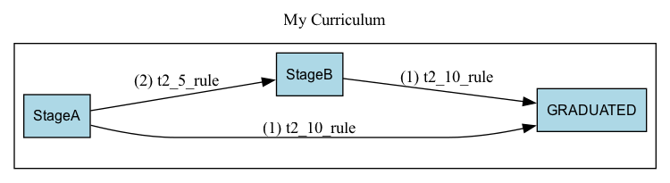

# aind-behavior-curriculum

[](LICENSE)
[](https://github.com/AllenNeuralDynamics/aind-behavior-curriculum/actions/workflows/ci.yml)
[](https://pypi.org/project/aind-behavior-curriculum/)
[](https://github.com/astral-sh/ruff)
[](https://github.com/astral-sh/uv)
[](https://pypi.org/project/aind-behavior-curriculum/)

Automate mouse training by describing a curriculum once, as code, and letting the library decide where each mouse goes next.

> [!WARNING]
> This library is still in development. Expect breaking changes in future releases.



## Overview

Tracking each mouse's training stage and setting the matching rig parameters by hand does not scale with the number of studies, experimenters and animals, and is prone to human error. `aind-behavior-curriculum` provides a small, typed framework to define that logic declaratively:

- **Tasks** hold validated rig/task parameters ([pydantic](https://docs.pydantic.dev/) models, so they serialize to JSON and ship with a schema).
- **Stages** wrap a task instance and are the nodes of a curriculum graph.
- **Stage transitions** are prioritized, rule-based edges between stages, triggered by **metrics** computed from a session.
- **Policies** (optional) update parameters *within* a stage, in parallel, without creating a new stage.
- A **Trainer** evaluates a mouse's current state against its latest metrics and proposes the next stage and parameters. A **TrainerServer** does the same for many subjects.
- **Export** a curriculum to JSON or a diagram to review it, and to share it across rigs.

## Installation

```bash
pip install aind-behavior-curriculum
```

Requires Python 3.11+. Diagram export additionally needs [Graphviz](https://graphviz.org/).

## Quick start

```python
from pydantic import Field

from aind_behavior_curriculum import (
    GRADUATED,
    Metrics,
    Stage,
    StageTransition,
    TaskParameters,
    create_curriculum,
    create_task,
)


class LickParameters(TaskParameters):
    reward_size: float = Field(default=2.0)


class MyMetrics(Metrics):
    n_trials: int = 0


LickTask = create_task(name="Lick Task", task_parameters=LickParameters)
MyCurriculum = create_curriculum(name="My Curriculum", version="0.1.0", tasks=(LickTask,))


def enough_trials(metrics: MyMetrics) -> bool:
    return metrics.n_trials > 200


stage = Stage(name="Stage 1", task=LickTask(task_parameters=LickParameters()))
curriculum = MyCurriculum(name="My Curriculum")
curriculum.add_stage_transition(stage, GRADUATED, StageTransition(enough_trials))
```

See the [getting started guide](https://allenneuraldynamics.github.io/aind-behavior-curriculum/intro/) for stages, policies and the trainer, and the [`examples/`](examples/) folder for complete curricula with generated diagrams.

## Documentation

Full documentation and API reference: [allenneuraldynamics.github.io/aind-behavior-curriculum](https://allenneuraldynamics.github.io/aind-behavior-curriculum/)

## Contributing

### Issues and Bugs

If you find any issues or bugs, please open an issue on [GitHub](https://github.com/AllenNeuralDynamics/aind-behavior-curriculum/issues)

### Suggesting changes and Pull Requests

If you would like to suggest changes or contribute to the project, please open a pull request on [GitHub](https://github.com/AllenNeuralDynamics/aind-behavior-curriculum/pulls).
Attempt to open a pull request that is scoped to a single issue or feature to make the review process easier.

#### Dependencies and lockfile

This project uses [`uv`](https://docs.astral.sh/uv/) for dependency management and lockfile generation.

You can create a new environment with:

```bash
uv venv
```

or run standalone commands with:

```bash
uv run <command>
```

#### Linting

This project uses:

`ruff` for linting. To lint the project, run the following commands:

```bash
uv run ruff format .
uv run ruff check .
```

`interrogate` for documentation analysis:

```bash
uv run interrogate --verbose .
```

and `codespell` for spell checking:

```bash
uv run codespell .
```

#### Testing

The project uses `pytest` for testing and `coverage` for coverage analysis.

```bash
uv run coverage run -m pytest
uv run coverage report
```
