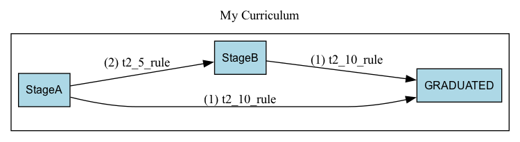

# Curricula and stages

A [`Curriculum`][aind_behavior_curriculum.curriculum.Curriculum] is structured as a graph of training [`Stage`][aind_behavior_curriculum.curriculum.Stage]s. Each stage is associated with a [`Task`][aind_behavior_curriculum.task.Task], which defines a set of configuration parameters via [`TaskParameters`][aind_behavior_curriculum.base.AindBehaviorModelExtra].

!!! important

    A [`Stage`][aind_behavior_curriculum.curriculum.Stage] wraps an **instance** of a [`Task`][aind_behavior_curriculum.task.Task], not the class itself. In other words, a stage is a container for a task that has been instantiated with its respective `TaskParameters`.

## Stages and transitions

Stages are connected by [`StageTransition`][aind_behavior_curriculum.curriculum.StageTransition]s, which are directed edges associated with a trigger condition. Stages and transitions form the nodes and edges of the curriculum graph. With this structure alone you can define a basic curriculum with skip connections and regressions. For nodes with multiple outgoing edges, edges are labelled by a priority set by the user.

<figure markdown>

<figcaption>
A curriculum made purely of stages and stage transitions. It has a skip connection between <code>StageA</code> and <code>Graduated</code>. Transitions trigger on a metric <code>t2</code>, and the skip transition is ordered before the one going to <code>StageB</code>.
</figcaption>
</figure>

!!! tip "Stages are checkpoints"

    Stages are intended to represent *checkpoint learning objectives* that wrap independent sets of parameters, for example `Stage1 = {P1, P2, P3}` → `Stage2 = {P4, P5, P6}`. If a curriculum keeps changing the *same* set of parameters, for example `Stage1 = {P1, P2, P3}` → `Stage1' = {P1', P2', P3}`, use [policies](policies.md) instead.

## Exploring the structure

The structure of the stage graph and of every policy graph can always be inspected with [`export_diagram`][aind_behavior_curriculum.curriculum_utils.export_diagram]. Edges are labelled with their priority rank, which makes it easy to validate your ordering. Use [`set_stage_transition_priority`][aind_behavior_curriculum.curriculum.Curriculum.set_stage_transition_priority] to reorder.
