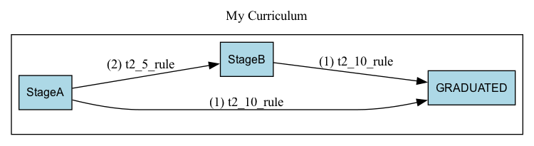

# aind-behavior-curriculum

<div class="badges" markdown>

[](https://github.com/AllenNeuralDynamics/aind-behavior-curriculum/blob/main/LICENSE)
[](https://github.com/AllenNeuralDynamics/aind-behavior-curriculum/actions/workflows/ci.yml)
[](https://pypi.org/project/aind-behavior-curriculum/)
[](https://github.com/astral-sh/ruff)
[](https://github.com/astral-sh/uv)
[](https://pypi.org/project/aind-behavior-curriculum/)

</div>

Automate mouse training by describing a curriculum once, as code, and letting the library decide where each mouse goes next.

!!! warning

    This library is still in development. Expect breaking changes in future releases.



<div class="grid cards" markdown>

- :material-rocket-launch: **[Getting started](intro.md)** — install the package and build your first curriculum.
- :material-graph-outline: **[Concepts](concepts/curriculum.md)** — stages, transitions, policies and the trainer.
- :material-hammer-wrench: **[Guides](guides/building.md)** — practical advice for building curricula, metrics and trainers.
- :material-code-braces: **[Examples](examples/index.md)** — complete curricula with their rendered diagrams.
- :material-book-open-variant: **[API reference](api/base.md)** — every public class and function.

</div>

## Overview

Tracking each mouse's training stage and setting the matching rig parameters by hand does not scale with the number of studies, experimenters and animals, and is prone to human error. `aind-behavior-curriculum` provides a small, typed framework to define that logic declaratively:

- **Tasks** hold validated rig/task parameters ([pydantic](https://docs.pydantic.dev/) models, so they serialize to JSON and ship with a schema).
- **Stages** wrap a task instance and are the nodes of a curriculum graph.
- **Stage transitions** are prioritized, rule-based edges between stages, triggered by **metrics** computed from a session.
- **Policies** (optional) update parameters *within* a stage, in parallel, without creating a new stage.
- A **Trainer** evaluates a mouse's current state against its latest metrics and proposes the next stage and parameters. A **TrainerServer** does the same for many subjects.
- **Export** a curriculum to JSON or a diagram to review it, and to share it across rigs.

## Installation

```bash
pip install aind-behavior-curriculum
```

!!! note

    Requires Python 3.11+. Diagram export additionally needs [Graphviz](https://graphviz.org/).
